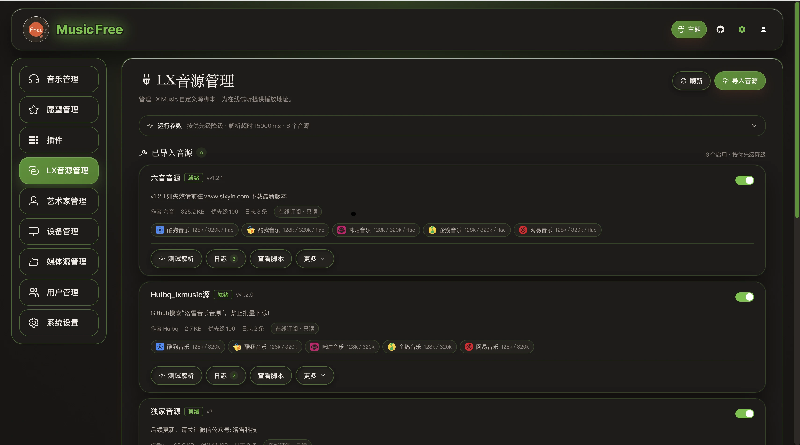

# 洛雪音源（LX Music）

相关文档：[音乐管理](/music) · [插件](/plugin) · [音乐分享](/share)

洛雪音乐（LX Music，社区也常写作「落雪」）的自定义音源是一类 `.js` 脚本：脚本接收歌曲信息，返回可播放的音频直链。MusicFree 从 **V1.2.8** 起接入这套能力，把「搜歌 → 试听 → 入库」串成一条链路。

> MusicFree **不内置任何音源脚本**，也不提供音源订阅地址。脚本由管理员自行导入，来源与合规性由使用者自行判断，请支持正版。



## 1. 能力概览

| 环节     | 入口                                 | 说明                                                           |
| -------- | ------------------------------------ | -------------------------------------------------------------- |
| **搜索** | 音乐管理 →「LX / 音源搜索」          | 原生支持酷我 / 酷狗 / QQ 音乐 / 网易云，脚本声明的平台自动加入 |
| **试听** | 结果行「试听」                       | 服务端签名代理，不暴露真实直链；临时试听，不进队列             |
| **入库** | 结果行「入库」                       | 下载落盘 → 写入标签 → 走既有扫描链路入库                       |
| **管理** | 后台管理 →「LX音源管理」`/admin/lxsource` | 导入、启用、排序、测试解析、查看日志                           |

## 2. 与 WASM 插件的关系

LX 音源引擎与 WASM 插件引擎是**并列的两套机制**，互不依赖：

| 维度         | WASM 插件搜索                            | LX / 音源搜索                                     |
| ------------ | ---------------------------------------- | ------------------------------------------------- |
| 扩展格式     | WASM 插件（`manifest.json` + `.wasm`）   | 洛雪 `.js` 音源脚本                               |
| 安装方式     | 插件商店 / 注册表                        | 后台「LX音源管理」导入                            |
| 擅长环节     | 搜索 + 下载入库（插件自带下载能力）      | 搜索 + **在线试听** + 下载入库                    |
| 依赖         | 需安装并启用 `RemoteSearch` 类插件       | 试听 / 入库需至少一个可用音源脚本                 |
| 相互影响     | 停用 LX 引擎后行为与升级前完全一致       | 停在 WASM 页签时不会发起任何 LX 请求              |

两套引擎共用「远程歌曲记录」结构，因此 LX 的搜索结果可以直接复用试听与入库链路，不影响既有的插件搜索 / 下载逻辑。

## 3. 导入音源脚本

入口：**后台管理 → LX音源管理**（`/admin/lxsource`），仅管理员可访问。

导入方式有两种：

| 方式             | 操作                                                             | 说明                                                                                       |
| ---------------- | ---------------------------------------------------------------- | ------------------------------------------------------------------------------------------ |
| **在线订阅**     | 填写脚本订阅地址，由服务端拉取                                   | 有地址合法性校验，内网地址会被拒绝；导入后为**只读**，不会自动更新，如需更新请删除后重新导入 |
| **音源脚本上传** | 点击或拖拽上传 `.js` 文件                                        | 导入后可在内置代码编辑器里查看与修改（行号、括号匹配、搜索、深色主题）                     |

导入时的行为约定：

- 脚本会先**编译校验**，失败不会写入。
- 上传来源的脚本保留 `rawScript` 原文（按字节保留），部分脚本会对原文做哈希校验。
- 单个脚本体积默认上限 **4 MiB**，超限直接拒绝。
- 导入后进入「待初始化 → 初始化中 → 就绪」流程；初始化失败会在卡片上显示错误原因。

## 4. 音源管理


每张音源卡片展示：

| 字段       | 含义                                                                       |
| ---------- | -------------------------------------------------------------------------- |
| 名称 / 版本 / 作者 | 来自脚本头部注释元信息                                              |
| 支持平台   | 脚本 `inited` 声明中带 `search` / `musicUrl` 能力的平台                    |
| 来源标签   | 「脚本上传 · 可编辑」或「在线订阅 · 只读」                                 |
| 运行状态   | 待初始化 / 初始化中 / 就绪 / 降级可用 / 异常 / 已停用                      |
| 优先级     | 数值越小越优先（默认 100），`fallback` 策略下按此顺序尝试                  |

常用操作：

| 操作         | 说明                                                                     |
| ------------ | ------------------------------------------------------------------------ |
| **测试解析** | 弹窗内搜歌，选中后自动填平台与歌曲 ID，查看命中的音源、音质、播放地址与逐源尝试记录（attempts），可一键复制直链 |
| **查看 / 更新脚本** | 只读查看脚本内容；上传来源的脚本可在弹窗中修改并保存（保存后会重新初始化） |
| **复制脚本** | 一键复制脚本原文，便于备份                                         |
| **重新加载** | 让引擎重新初始化该脚本（修改脚本或上游变动后使用）                       |
| **启用开关** | 单个音源独立启停；停用后不参与搜索与解析                                 |
| **删除**     | 二次确认后删除脚本文件                                                   |

每张卡片独立显示进行中状态，避免重复点击触发并发操作。

### 4.1 测试解析的失败提示

失败提示会区分两类问题：

- **测试参数不全**：缺少平台 ID 等必填项，属于操作问题。
- **上游 / 版权不可用**：平台接口不可用或受版权限制，属于音源侧问题，可换平台或换音源重试。

### 4.2 引擎开关与日志

- 可整体停用 LX 引擎：停用后导入与解析都不生效，音源相关入口不再产生请求。
- 每个音源保留独立的诊断日志（环形缓冲，默认最近 200 条），用于区分「脚本问题」还是「上游接口问题」。

## 5. 搜索

「音乐管理」页顶部是**双引擎**：`WASM 插件搜索` 与 `LX / 音源搜索`，切换互不影响。

### 5.1 原生四平台

酷我（`kw`）、酷狗（`kg`）、QQ 音乐（`tx`）、网易云（`wy`）由 Go 侧实现，**无需导入脚本即可搜索**。平台用彩色图标展示，支持多选组合。

### 5.2 脚本自描述平台

导入的脚本如果在 `inited` 事件里声明了 `search` 能力（例如汽水音乐 `qs`），该平台会自动出现在平台列表里，搜索结果直接复用试听 / 入库链路，不需要为新平台改代码。

### 5.3 结果与互不串台

- 切换引擎会清空上一次的结果与解析状态，异步返回的旧请求会被丢弃。
- 停留在 `WASM 插件搜索` 页签时不会发起任何 LX 请求，也不显示试听 / 入库 / 音源状态栏。
- 搜索本身只返回歌曲信息与平台标识；真正取到播放地址需要可用的音源脚本，因此「原生平台能搜到」但「没有音源脚本时不能试听 / 入库」属于预期行为。

## 6. 在线试听

结果行点击「试听」即可播放，行为要点：

- **签名代理**：音源解析出的直链由服务端签发短时播放令牌（默认 **60 分钟**），浏览器只拿到站内代理地址，避免变成公开的「任意 URL 代理」。
- **支持拖动进度条**：代理透传 `Range` / `HEAD` 与 `206 Partial Content`，在线歌曲也能跳转与续流。
- **防盗链兼容**：按源自动补 `Referer` / `User-Agent`，重定向逐跳复检；单次响应有体积上限（默认 **256 MiB**），超时（默认 **5 分钟**）自动断开。
- **临时试听**：试听只驱动当前播放，**不加入播放队列、不写入本地播放记录**；播放器条显示「试听 · 在线」标记与关闭按钮，试听结束或手动关闭后即释放，刷新页面不会残留过期链接。
- **音质自动降级**：按 `flac24bit → flac → 320k → 128k` 逐级尝试，脚本不支持所选音质时自动退到可用档位。
- **解析诊断**：结果行会显示本次命中的音源与音质；失败时可打开「LX 音源解析诊断」查看每个音源的尝试结果（耗时、错误原因）。

> 在线试听曲目暂不支持投屏，也不提供歌词；需要完整播放能力时请先「入库」。

## 7. 下载入库

点击「入库」后：

1. 服务端按令牌拉取音频，写入音乐库目录。
2. 按「歌名 - 艺术家」生成文件名，重名自动加序号。
3. 把标题、艺术家写入音频标签（同时写入 album artist）。
4. 交给**既有扫描链路**入库（`ProcessSingleFile` + 增量扫描），不会绕过扫描直接建库记录。

入库后的歌曲就是普通曲库歌曲：可以加入歌单、被 Subsonic / OpenSubsonic 客户端搜索、参与转码与投屏。

失败时会明确提示原因（上游 403 / 版权不可用 / 超时 / 内容为空），不影响其它歌曲继续操作。

## 8. 安全边界

- **沙箱运行**：每个脚本运行在独立 JS 运行时中，有内存上限（默认 64 MiB）、初始化 / 单次解析 / HTTP 请求超时，超时会标记异常并重建，不会拖死整个服务。
- **默认禁止访问内网**：脚本发起的请求默认拒绝环回、内网与云元数据地址（SSRF 防护），重定向同样复检；确需访问内网可显式开启 `allow_private_network`。
- **域名白名单**：`allow_hosts` 非空时，脚本只能访问列表内主机（支持 `*.example.com`）。
- **体积与并发限制**：脚本体积上限、并发初始化数量（默认 4）可配置，`race` 策略下同样受并发上限约束。
- **令牌密钥**：签名密钥复用系统 JWT 密钥；如果仍在使用默认密钥，会退化为进程内随机密钥——此时**重启后旧的试听链接失效**，重新点一次试听即可。

## 9. 配置

三个配置段均可省略，默认即推荐值：

```yaml
lxsource:
  enabled: true # 总开关；停用后导入与解析都不生效
  root: ./data/lx_sources # 脚本与 sources.json 存放目录
  init_timeout_ms: 20000
  request_timeout_ms: 15000
  http_timeout_ms: 10000
  memory_limit_mb: 64 # 单脚本 JS 堆上限
  max_concurrency: 4 # 并发初始化 / 竞速上限
  strategy: fallback # fallback 按优先级依次尝试 | race 全部竞速
  max_script_bytes: 4194304 # 脚本体积上限（4 MiB）
  allow_hosts: [] # 非空时限制脚本可访问域名，支持 *.example.com
  allow_private_network: false # 是否允许访问环回 / 内网地址

lxsearch:
  enabled: true
  timeout_ms: 10000
  default_limit: 30
  user_agent: "" # 留空使用默认浏览器 UA
  sources: [kw, kg, tx, wy] # 只启用部分原生平台时在此收窄

remote_play:
  enabled: true
  token_ttl_minutes: 60 # 试听令牌有效期
  max_stream_mb: 256 # 单次代理 / 下载体积上限
  stream_timeout_minutes: 5
  download_dir: "" # 留空写入默认媒体源音乐目录
```

## 10. 接口一览

以下接口均为管理端接口，前缀 `/rest/api/v1`，需管理员登录（`remote-play/stream` 例外：只需登录 + 有效令牌）。

| 方法       | 路径                                | 说明                       |
| ---------- | ----------------------------------- | -------------------------- |
| `GET`      | `/lxsource/config`                  | 引擎运行参数与平台 / 音质枚举 |
| `GET`      | `/lxsource/sources`                 | 音源列表                   |
| `POST`     | `/lxsource/sources`                 | 导入（脚本内容或订阅地址） |
| `GET/PUT/DELETE` | `/lxsource/sources/:id`        | 查看 / 更新 / 删除音源     |
| `GET`      | `/lxsource/sources/:id/script`      | 查看脚本原文               |
| `GET`      | `/lxsource/sources/:id/logs`        | 音源诊断日志               |
| `PUT`      | `/lxsource/sources/:id/enable`      | 启用 / 停用                |
| `PUT`      | `/lxsource/sources/:id/priority`    | 调整优先级                 |
| `POST`     | `/lxsource/sources/:id/reload`      | 重新加载脚本               |
| `POST`     | `/lxsource/test`                    | 测试解析                   |
| `POST`     | `/lxsource/resolve`                 | 按歌曲信息解析播放地址     |
| `GET`      | `/lxsource/search/platforms`        | 脚本声明的可搜索平台       |
| `POST`     | `/lxsource/search`                  | 脚本搜索                   |
| `GET`      | `/lxsearch/providers`               | 原生平台适配器及可用状态   |
| `GET`      | `/lxsearch/config`                  | 原生搜索配置               |
| `POST`     | `/lxsearch/search`                  | 原生平台搜索               |
| `GET`      | `/remote-play/providers`            | 两套引擎与播放能力总览     |
| `POST`     | `/remote-play/resolve`              | 解析并签发试听令牌         |
| `POST`     | `/remote-play/download`             | 凭令牌下载入库             |
| `GET/HEAD` | `/remote-play/stream?token=...`     | 签名代理播放（支持 Range） |

## 11. 常见问题

**Q：导入脚本后状态一直是「异常」？**  
A：先点卡片上的「重新加载」，再查看该音源的日志。常见原因是脚本初始化时需要联网校验而域名被拦截，可在 `allow_hosts` 放行，或确认网络可访问上游。

**Q：搜索有结果，但试听 / 入库报「音源不适用」或「上游不可用」？**  
A：搜索只负责找歌，播放地址由音源脚本解析。确认该平台在脚本 `inited` 声明中带 `musicUrl` 能力，并换平台或换音源重试；本项目不修复、不内置第三方音源。

**Q：试听链接过一会儿就打不开了？**  
A：试听地址带 60 分钟有效期（`remote_play.token_ttl_minutes`），过期后重新点一次试听即可。另外若仍在用默认 JWT 密钥，重启后旧链接会失效。

**Q：试听会出现在播放记录里吗？**  
A：不会。试听不入队、不写播放历史；只有「入库」后的歌曲才按本地歌曲统计。

**Q：Docker 部署要注意什么？**  
A：音源脚本默认存放在 `./data/lx_sources`，请确保 `/app/data` 已挂载并持久化，否则重建容器会丢脚本；下载目录同样需要落在已挂载的音乐目录内。

## 12. 版权与合规

请仅在合法授权范围内使用自定义音源，尊重版权方与音源作者的劳动成果；公开分享或对外提供服务时，请注意所在地法律法规。
