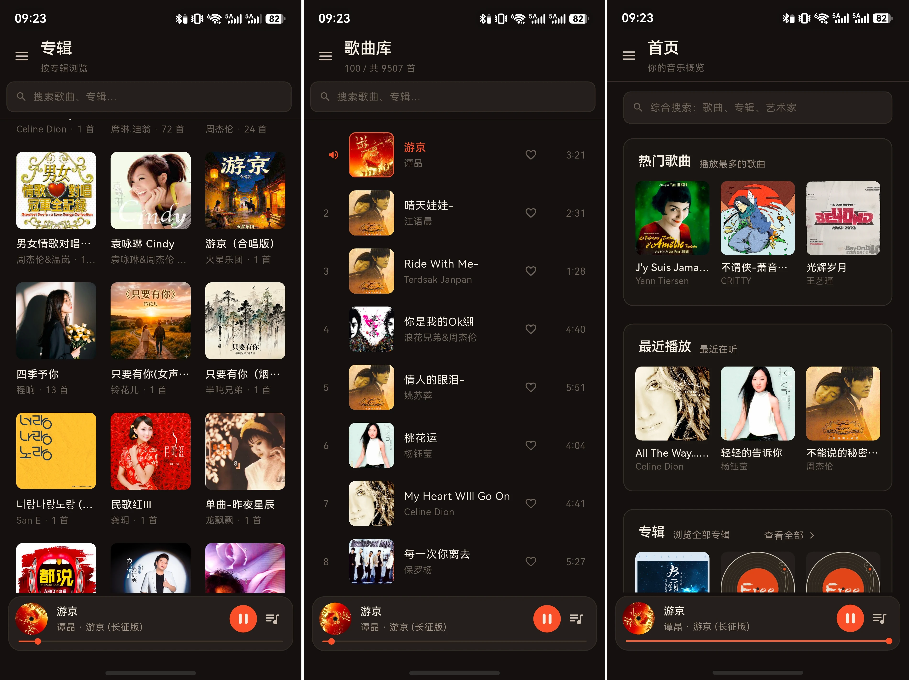

# MusicFly 客户端

相关文档：[功能特性](/feature) · [音乐管理](/music) · [发布日志](/changelog)

**MusicFly（乐记）** 是 MusicFree 的官方客户端，基于 Flutter 编写，覆盖 **Windows、macOS、Android、iOS、鸿蒙**。它通过 MusicFree 的 HTTP / OpenSubsonic 接口连接你自己的服务器，浏览曲库、播放音乐并显示歌词；浏览器访问与第三方 Subsonic 客户端仍然可用，MusicFly 只是多了一个更贴合手机与桌面的入口。

## 下载

下载地址：**[github.com/AnsGoo/music-fly/releases](https://github.com/AnsGoo/music-fly/releases)**（也可从源码自行构建，仓库见 [AnsGoo/music-fly](https://github.com/AnsGoo/music-fly)）

| 平台        | 安装包                                                                 | 说明                                                     |
| ----------- | ---------------------------------------------------------------------- | -------------------------------------------------------- |
| **Windows** | `MusicFly-<版本>-windows-x64-setup.exe` / `-windows-x64.zip`           | 安装版装到当前用户目录，无需管理员权限；zip 为免安装版   |
| **macOS**   | `MusicFly-<版本>-macos.dmg`                                            | 拖入「应用程序」即可                                       |
| **Android** | `musicfly-android-v<版本>.apk`                                         | 直接安装；`.aab` 供应用商店分发使用                       |
| **iOS**     | `musicfly-ios-v<版本>-unsigned.zip`                                    | 未签名包，需自行签名后安装                                 |
| **鸿蒙**    | `musicfly-harmony-v<版本>-unsigned.hap`                                | 未签名包，需签名后在开发者模式安装                         |

各平台安装要点：

- **Windows**：安装版带开始菜单项、可选桌面快捷方式和卸载程序，安装界面支持中英文；免安装版解压后运行 `MusicFly/musicfly.exe`。首次运行如被 SmartScreen 拦截，选择「更多信息 → 仍要运行」。
- **macOS**：安装包为 ad-hoc 签名，拷贝到其他机器后首次打开需**右键 → 打开**（或在「系统设置 → 隐私与安全性」中允许）。
- **Android**：允许「安装未知来源应用」后安装 APK；Android 13+ 首次播放会请求通知权限，拒绝后暂停时锁屏媒体控制器会消失（可在系统设置中重新授予）。
- **iOS**：Release 提供的是未签名包，需要用自己的开发者证书签名后安装（Xcode、AltStore 等工具均可）。
- **鸿蒙**：Release 提供的是未签名 HAP，需用开发者证书签名，并在开发者模式下安装。

## 连接自己的服务器

安装后打开应用，在「设置 → 服务器」中填写：

| 字段     | 说明                                                                 |
| -------- | -------------------------------------------------------------------- |
| 服务器地址 | 局域网填 NAS 地址（如 `http://192.168.1.10:14533`）；外网填已做反向代理并带 HTTPS 的域名 |
| 账号     | MusicFree 的登录账号（默认 `admin`，部署后请尽快修改）               |
| 密码     | 对应账号密码                                                          |

登录成功后会话保存在本地，下次打开直接进库。

**多地址自动切换**：普通登录可添加多个备用地址（局域网 + 外网），App 每 2 分钟探测一次并优选延迟最低的地址；当前地址请求失败时会立即重新探测，在家走内网、出门自动切外网，不需要手动改配置。

> 地址不要带 `/rest` 后缀，也不要填飞牛网关路径 `/app/musicfree` —— 那是浏览器入口，客户端请使用服务端地址与端口。

## 飞牛 FNID 登录

在已接入飞牛统一网关的 NAS 上（服务端 **V1.2.7 及以上**），可以直接用**飞牛账号（FNID）**登录，不必再单独记住 MusicFree 的账号密码：

1. 登录页选择「飞牛账号（FNID）」。
2. 输入飞牛账号完成校验；首次使用需要完成过一次「NAS 账号 ↔ MusicFree 账号」绑定（未绑定时会引导输入一次应用账号密码），详见 [发布日志 V1.2.7](/changelog#v1-2-7)。
3. 绑定后客户端即可免密进入，播放、封面、下载凭证一并就绪。

FNID 登录会把飞牛解析出的链路（内网 IP、公网 IPv4 / IPv6、统一网关、中继域名）保存为内部故障切换池：在家走内网，离开内网自动切到公网 / 网关 / 中继，设置页只显示当前连接的一条只读地址。开启两步验证（2FA）的账号，在设备未被信任前需要在「外网自动切换」里填一次动态码。

## 功能

- **浏览**：歌曲、专辑、艺术家、歌单、收藏五个分区，滚动到底自动翻页，列表带专辑封面。
- **搜索**：关键词搜索歌曲，结果可直接加入播放队列。
- **播放**：队列上下首、拖动进度、音量调节，播放结束自动续下一首；坏源自动跳过并说明原因。
- **后台播放**：锁屏、切后台、拔耳机继续播放；Android 走前台服务 + MediaSession（通知栏 / 锁屏 / 蓝牙按键可控），iOS 与鸿蒙同样支持后台音频与锁屏控制。
- **歌词**：读取服务端内嵌歌词，LRC 逐行高亮并跟随播放进度。

> MusicFly 消费的是**已入库**的曲库：远程搜索下载、在线试听、去重、刮削等运维能力仍在 Web 管理端（`/admin`）完成。

## 与服务端版本的关系

- MusicFly 可直接连接 **V1.2.7 及后续版本**的 MusicFree 服务端，升级服务端不需要重装客户端。
- 服务端保持默认端口 `14533` 即可，不需要为客户端做额外配置；飞牛原生应用用户可用 `https://<NAS 域名或 IP>/app/musicfree` 打开网页端，但客户端连接仍使用地址 + 端口。
- 外网访问请自行配置反向代理与 HTTPS，并保证 `/rest` 接口可访问。

## 常见问题

**Q：客户端提示连接失败 / 401？**  
A：先确认地址与端口正确（不要填 `/rest`、不要填网关路径）、账号密码可用；再用浏览器访问 `http://<地址>:14533/rest/ping.view` 验证服务端是否可达。

**Q：局域网能连，出门就断？**  
A：普通登录请在「设置 → 服务器」添加外网地址作为备用，App 会自动优选；FNID 登录会自动维护故障切换池，无需手动配置。

**Q：封面、字体显示不出来（404）？**  
A：这是服务端旧版本在网关入口下的已知问题，升级到 **V1.2.8** 并强制刷新即可，详见 [发布日志 V1.2.8](/changelog)。

**Q：能直接在客户端里搜歌下载吗？**  
A：不能。客户端的定位是「听歌」，搜索下载与入库请在 Web 管理端 `/admin/music` 完成（支持 WASM 插件与 [洛雪音源](/lx-source)）。

**Q：iOS / 鸿蒙安装包为什么是 unsigned？**  
A：Release 未附带签名证书。iOS 需自行签名（Xcode / AltStore 等），鸿蒙需用开发者证书签名后在开发者模式安装。

## 反馈

- 客户端问题：[music-fly Issues](https://github.com/AnsGoo/music-fly/issues)
- 服务端问题：[提交 Issue 规范](/feedback)
